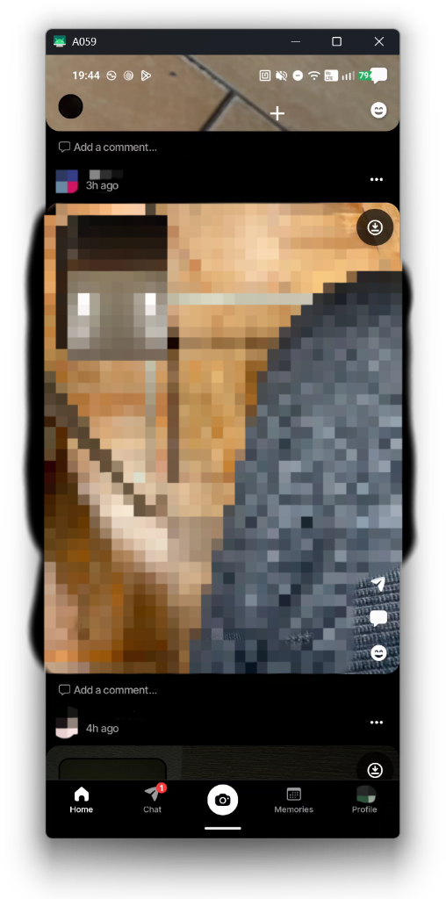
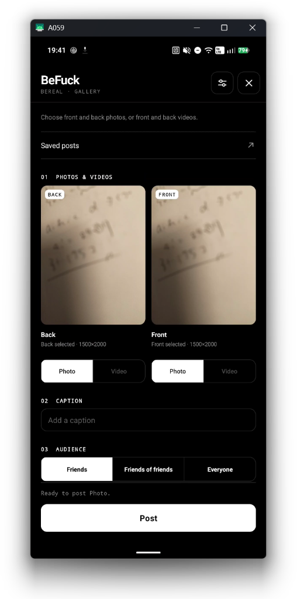
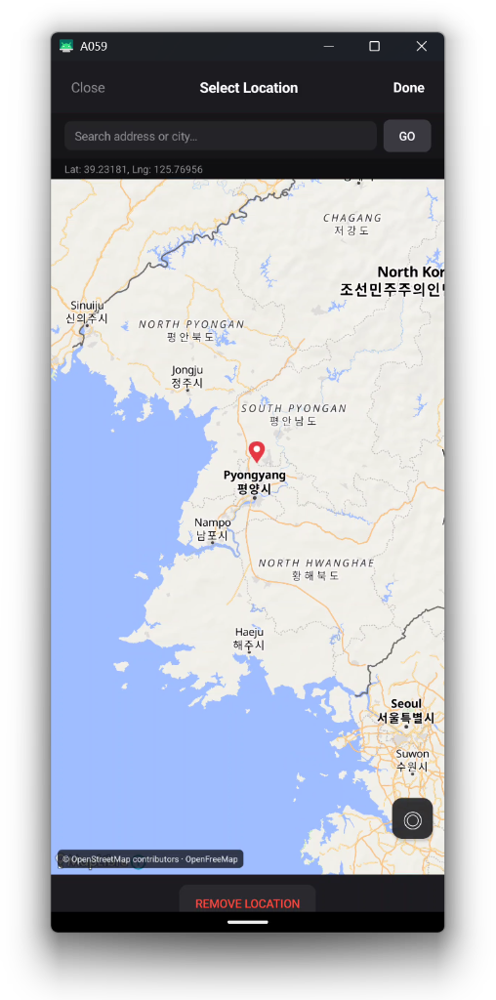
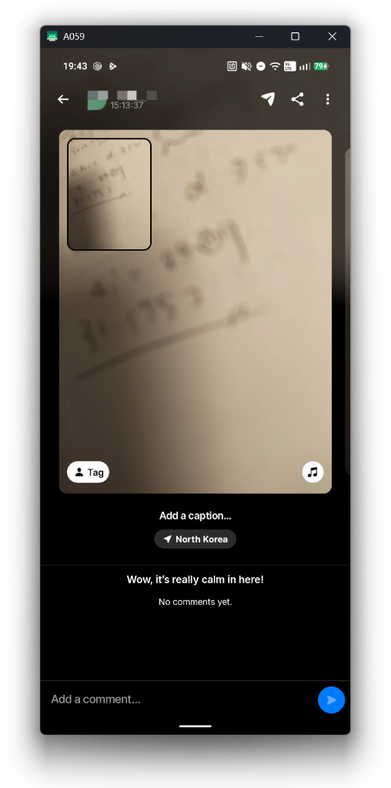
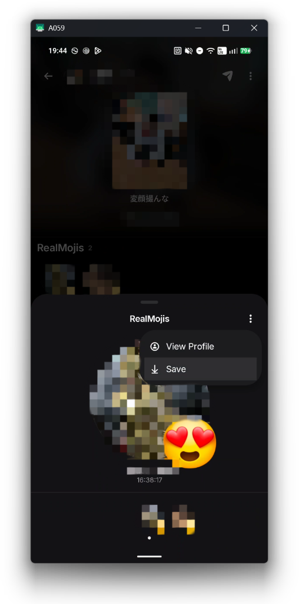

# BeFuck

[English](README.md) · [简体中文](README.zh-CN.md) · [日本語](README.ja.md) · [한국어](README.ko.md)

An Xposed module for BeReal.  
Supports **LSPosed** and **NPatch**.  
Supported BeReal versions: **3.97.0 (3597523)** / **3.97.1 (3599414)** (`com.bereal.ft`).

## Screenshots

| Unblur & Download | Gallery Posting | Location Picker |
| :---: | :---: | :---: |
|  |  |  |

| Posted Result (Time & Location Spoof) | Save RealMojis |
| :---: | :---: |
|  |  |

## Features

- **Unblur**: View blurred posts and timeline cards without restrictions.
- **Save Media**: Save photos, videos (BTS), and RealMojis directly to your device with original timestamps.
- **Gallery Posting**: Post photos or videos directly from your gallery (supports cropping, captions, location, and late posting).
- **Video Editing**: Crop and rotate in portrait 3:4, and trim clips up to 30 seconds with thumbnail timeline preview. Both clips are automatically aligned in duration.
- **Ad Blocker**: Hide sponsored posts and feed ads.
- **Post History**: View and download previously loaded posts anytime.

## How to Use

1. Install and enable the module in LSPosed (or embed/patch with NPatch), selecting **BeReal (`com.bereal.ft`)** in the scope.
2. Open BeReal.
3. Tap the **+** button beside the Home feed title to access gallery posting, saved posts, and settings. You can also save directly from post menus.

> [!NOTE]
> **Login**:
> - **v0.3.0+**: Fixed to support phone number verification (SMS login).
> - **Workaround for v0.2.0 and earlier, or if login fails**:
>   - Phone number verification (SMS login) may fail if the module is hooked before logging in (email login works normally).
>   - If you want to log in via SMS, please complete the login first with the module disabled, then enable (hook) the module.
>   - In embedded environments like NPatch where login fails, please use **email login**.

Saved files location: `Pictures/BeFuck` or `Movies/BeFuck`.

After a BeReal or module update, symbol signatures are rebuilt automatically on the next launch. Saved posts, SQLite backups and feature settings are retained.

## Build

Requires JDK 17+ and Android SDK.

**Windows (PowerShell)**

```powershell
.\gradlew.bat :app:assembleDebug
```

**Linux / macOS**

```sh
chmod +x gradlew
./gradlew :app:assembleDebug
```

Output APK: `app/build/outputs/apk/debug/app-debug.apk`

## License

Copyright 2026 **tqmane**. [PolyForm Noncommercial 1.0.0](LICENSE).

## Saved-post backup and merge

Saved post URLs, author UID/name, posting/capture times and captions are stored in relational SQLite columns. Open **Saved posts → Backup and merge** to export a `.sqlite` file or preview and merge a backup from another device using the same account. Duplicate post IDs are merged without deleting existing posts; full URL alternatives and per-field observation times are retained. Old unassigned data requires explicit account association. Backups are unencrypted and contain signed URLs, not photo/video files or login credentials. This is manual file transfer, not background synchronization. See [backup details and limits](docs/archive-backup.md).

## Saved media previews

Saved posts show small back/front previews. Tap a preview for a full-screen viewer; swipe between the two cameras of that post, pinch/double-tap photos to zoom, and save either from the card or inside the viewer. Videos show a poster and load playback only after Play. The black/white Material/Tabler UI, calendar and SQLite backup are retained. Preview downloads are temporary and not included in backups. [Behavior and verification](docs/saved-media-preview.md).
